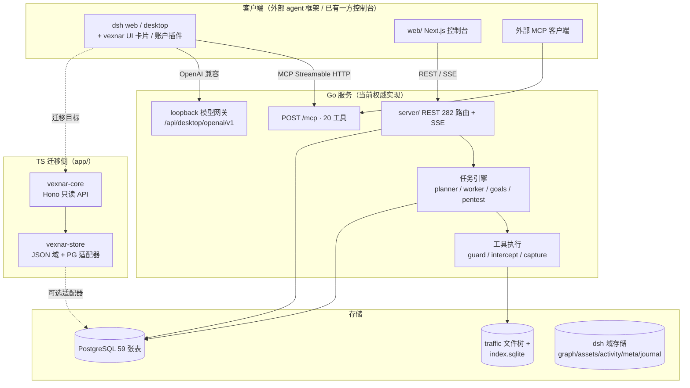
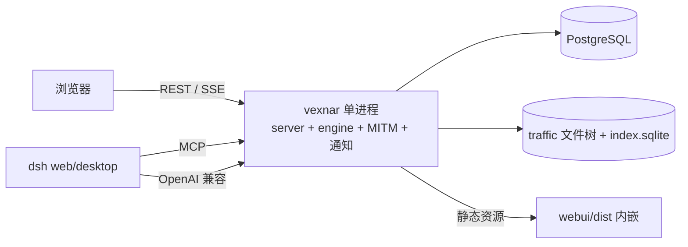
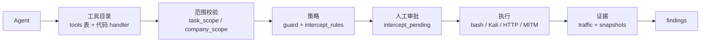

<!--
  Copyright (c) 2026 xuzhongxin <xuzhongxin@sec.hn.cn>
  Repository: https://github.com/zhongxinxuhk/VEXNAR
  SPDX-License-Identifier: AGPL-3.0-or-later
-->

# VEXNAR 企业级 Agent 架构：Local-first 存储与运行时实施蓝图

> 版本：2.0（现状对齐版，2026-11-21）
> 上一版本：1.0（架构锁定稿，前提是"TypeScript 全栈一次性重写 + Electron 一方客户端"）
> 项目：VEXNAR
> 主仓库：https://github.com/zhongxinxuhk/VEXNAR
> 参考项目：ZCode（桌面壳与 UI）、DeepSeek Harness / dsh（Agent 运行时与客户端壳）
> 文档用途：源码级实施依据。**所有"现状"条目可用 §0.2 的命令复核；所有"目标"条目都标注了状态。**

**本版修订范围**：把 v1.0 与代码事实冲突的部分对齐到仓库实测（语言与进程形态、默认数据库、客户端归属、模块落点、阶段进度）；**§11（ZCode + dsh 融合 UI）原样保留，本版不改动**。文件名沿用 v1.0 的历史命名，实际存储决策见 §0.4 与 §4。

---

## 0. 现状事实与决策基线

### 0.1 一句话现状

VEXNAR 当前是 **Go 单体服务 + PostgreSQL + 内嵌 Next.js 控制台** 的可用产品：

- `server/` 提供 282 条 REST 路由、`POST /mcp`（20 个领域工具）和 loopback 模型网关；
- `db/` 用 `schema.sql` 管理 60 条 `CREATE TABLE`（59 张唯一表；`desktop_projects` 有两处声明），启动时在 advisory lock 下幂等建表；
- `agent/` 基于 `norma v0.4.3` 跑 planner / worker / mainagent / goals / pentest 的自主闭环；
- `traffic/` 用 go-mitmproxy 逐请求落文件树，并以 SQLite 建检索索引（**当前唯一的 SQLite 用途**）；
- 第一方桌面客户端（Electron / Tauri）已于 2026-11-21 移除，客户端改由外部 agent 框架（dsh）在 `app/` 重建；
- TypeScript 侧以 `app/vexnar-core`（Hono + Kysely 只读 API，20 端点）与 `app/vexnar-store`（dsh 风格 JSON 域存储 + PG 适配器）两片增量接手，**不是一次性重写**。

### 0.2 实测基线（可复核）

| 指标 | 数值 | 复核方式 |
|---|---:|---|
| Go 生产代码 | 71,542 行 | `find . -name '*.go' ! -name '*_test.go' ! -path './参考项目/*' \| xargs wc -l \| tail -1` |
| Go 测试代码 | 34,830 行 / 177 文件 | 同上加 `*_test.go` |
| REST 路由 | 282 条 | `grep -rho 'mux.HandleFunc("[^"]*"' server/*.go \| wc -l` |
| PostgreSQL 表 | 60 条声明 / 59 张唯一表 | `grep -c 'CREATE TABLE' db/schema.sql`；`desktop_projects` 在 590 与 995 行各声明一次 |
| MCP 工具 | 20 个 | `server/mcp.go`：15 个领域工具 + `traffic_search`/`traffic_get`/`traffic_blob` + `list_assets` + `create_task` |
| 通知通道 | 6 类（钉钉 / 飞书 / 企微 / Webhook / Telegram / 邮件） | `notify/` |
| 内嵌前端 | Next.js `^16.2.9`，静态导出 | `web/` → `web/out` → `server/webui/dist`（`build.sh`），`server/webui_embed.go` 的 `//go:embed all:webui/dist` |
| TS 只读 API | 20 个 GET 端点 | `app/vexnar-core/src/routes.ts` |
| 上游 dsh | tag `dsh-v0.2.2-rc.5` / commit `9c2670d3…` / MIT | `app/upstream.lock.json` |
| Go 关键依赖 | norma v0.4.3、go-mitmproxy v1.9.2、pgx v5.10.0、modernc.org/sqlite v1.52.0、dnsx | `go.mod` |

> `app/MIGRATION.md` 记录的路由基线是 275 条（写作时点），之后新增了 MCP 与桌面网关相关路由，实测为 282 条。**以本节命令的输出为准**，不以文档数字为准。

### 0.3 决策表：已锁定 / 已变更 / 待定

**已锁定（v1.0 与 v2.0 一致，继续有效）**

| 维度 | 方案 |
|---|---|
| 权威归属 | 只保留一个权威实现：领域真相来自 Go 服务；客户端只是表现与控制面 |
| 数据源 | 同一业务实体任何时刻只有一个写后端，禁止双主写入 |
| 外部接缝 | 只有两条：`POST /mcp`（领域工具）与 loopback OpenAI 兼容网关（模型） |
| 客户端边界 | 客户端不维护第二套模型目录，不复制会话/任务真相，不绕过审批语义 |
| 许可 | 根 `LICENSE` 为 AGPL-3.0-or-later；上游 dsh 保持 MIT 原样 |

**已变更（v1.0 的假设被现实推翻）**

| 维度 | v1.0 写法 | 现实（2026-11-21） | 影响 |
|---|---|---|---|
| 开发语言 / 形态 | "TypeScript 全栈 + Electron，pnpm monorepo" | Go 单体是权威实现；TS 在 `app/` 增量接手 | 迁移是"按域换语言"，不是"先搭 monorepo 再重写" |
| 默认数据库 | "SQLite 默认且权威，PostgreSQL 可选" | Go 的权威库是 PostgreSQL（59 张唯一表）；SQLite 只做 traffic 索引；新栈默认是 dsh 风格 JSON 域，PG 降为可选适配器 | 三套存储各有明确边界，见 §0.4 |
| 一方桌面客户端 | Electron 壳 + 类型化 IPC | 已移除（`apps/desktop`、`desktop/`、Tauri 壳） | 桌面/窗口/安装/签名的归属移出本仓库 |
| 多 Worker + Redis | "Coordinator + Worker 注册表 + 租约 + 可选 Redis" | 没有 Redis、没有 worker 注册表；并发由 PG 承担 | 租约/注册表属于目标设计，不是现状，见 §5.5、§6.2 |
| 模块落点 | `packages/*` 二十余个包 | `server/ db/ agent/ traffic/ intercept/ notify/ mcphttp/ mcpserver/` 等 Go 包 + `app/vexnar-*` 两个 TS 包 | §8 给出真实文件级映射 |

**待定（本版不改）**

| 主题 | 说明 |
|---|---|
| ZCode + dsh 融合 UI | 见 §11，按用户要求原样保留，不在本版讨论范围内 |

### 0.4 三种存储的真实分工

| 存储 | 位置 | 谁写 | 装什么 | 权威性 | 约束 |
|---|---|---|---|---|---|
| PostgreSQL | `VEXNAR_PG_DSN` 或 `config.json → database` | 只有 Go 服务 | 59 张唯一表：任务、探索图、漏洞、资产、会话、审批、LLM、通知… | **当前权威** | 启动期 `pg_advisory_lock(7337741001)` 串行建表；连接池上限 32；DSN 无默认值，缺失即启动失败 |
| SQLite（`index.sqlite`） | `traffic/<task>/_index/index.sqlite` | `traffic/` 包 | 流量索引与全文检索（正文另存文件树） | 派生物，可重建 | 单任务单库；`auto_vacuum=INCREMENTAL` 才能回收空间；不参与领域事务 |
| dsh 风格 JSON 域 | `$DSH_HOME/vexnar/store` 或 `VEXNAR_STORE_ROOT` | 只有 `vexnar-core`（单写者锁） | graph / assets / activity / meta / journal 五个域 | **迁移目标**（当前只覆盖读模型与已导入数据） | 无跨表事务、无二级索引、`domain/changed` 仅进程内；PG 仅作可选适配器 |

三条不可违反的规则：

1. **不双写**：JSON 域与 PostgreSQL 不同时写同一实体。`VEXNAR_STORE` 是整体切换开关，不是并行开关。
2. **不双主**：流量索引不是证据本体；证据以 Go 的 `traffic_evidence_snapshots` + 文件树为准。
3. **不混用**：dsh 自己的 `workspace` / `session` / `profiles` 域不属于 VEXNAR，VEXNAR 只写 `vexnar/*`。

### 0.5 与其它文档的关系

| 文档 | 回答什么 |
|---|---|
| `app/MIGRATION.md` | Go → TypeScript 的可行性、工作量、阶段计划、P0 四组 spike 结果 |
| `app/STORAGE-ARCHITECTURE.md` | 存储域划分、读写路径、性能预算、崩溃恢复 |
| `app/UPSTREAM.md` | 上游 dsh 的只读边界、升级与回滚 |
| `app/README.md` | `app/` 工作区怎么跑、怎么隔离 home、两条消费链 |
| `docs/mcp-server-方案.md` | `/mcp` 的传输、鉴权、工具面与后续收敛 |
| `docs/多Agent运行时架构设计方案.md` | 多 Agent 运行时（调度、DAG、委派）的目标设计 |
| `docs/VEXNAR_MCE_完整架构设计方案_v1.0.md` | 记忆 / 缓存 / 上下文引擎的目标设计 |
| `AGENTS.md` | 仓库约定：客户端边界、分支与合并、许可证头 |

本文是**上位蓝图**：只决定边界、落点与验收口径，不重复上述文档的细节。

---

## 1. 项目目标与上游分工

### 1.1 最终产品目标

VEXNAR 应成为拥有独立 Agent Runtime、任务引擎、Security Engine、工具/插件体系和可用控制台的本地优先安全 Agent 平台，而不是 ZCode 与 DSH 的简单拼接。

同时满足三条现实约束：

1. **不中断在用部署**：Go 服务与 PostgreSQL 是存量真相，迁移期间必须可回退。
2. **不引入强制外部依赖**：单机部署不得强制 Redis、向量库或其他中间件。
3. **不让客户端长出第二套真相**：任务、漏洞、流量、资产永远只有一个来源。

### 1.2 上游职责

| 项目 | 参考范围 | 使用原则 |
|---|---|---|
| ZCode | 桌面壳、桌面生命周期、Chat/Project/Workspace 的 UI 形态、RPC | 选择性移植与适配；**UI 融合细节见 §11，本版不改** |
| DSH (dsh) | Agent Loop、Session、工具管线、Subagent/Team、Plugin、客户端壳、存储域模型 | 锁定 tag 后只读引入，作为 VEXNAR 的运行时与客户端壳 |
| VEXNAR | 安全领域模型、自主探索、双图、工具执行策略、证据与报告、任务引擎 | 保留业务所有权 |

参考仓库：

- ZCode：https://github.com/zai-org/ZCode
- DSH：https://github.com/deepseek-ai/deepseek-harness
- VEXNAR：https://github.com/zhongxinxuhk/VEXNAR

上游锁定值（实测）：`app/upstream.lock.json` → `dsh-v0.2.2-rc.5` / `9c2670d3bce5275e0d1610272958121af87787bb` / MIT。升级只走 `npm run upstream:check`（27 项断言）+ `npm run upstream:upgrade`（失败自动回滚）。

### 1.3 核心原则

1. 只保留一个权威 Agent Runtime 与一个权威数据源。
2. Go 服务是当前行为基线；TS 侧在兼容性对账通过前不得宣称"已迁移"。
3. 所有跨进程通信走版本化契约（REST JSON / SSE / MCP / OpenAI 兼容）。
4. UI 不直接访问数据库或执行安全工具。
5. 所有工具执行必须经过范围校验与审批策略。
6. 本地部署不得强制依赖外接 PostgreSQL、Redis 或远程服务（当前单机形态：Go + 本地 PG）。
7. 任务、事件、审批、证据必须可持久化、可恢复、可审计。
8. 同一实体同一时刻只有一个写后端。

---

## 2. 仓库现状结构（实测）

```text
VEXNAR/
├── server/            # Go：HTTP 路由、任务引擎、管理面、MCP、模型网关
├── db/                # Go：PostgreSQL 数据层 + schema.sql（59 张表）+ seed
├── agent/             # Go：提示词、工具目录、planner/worker/mainagent/goals/pentest
├── traffic/           # Go：MITM 采集（go-mitmproxy）+ 文件树 + SQLite 索引
├── intercept/         # Go：危险操作审批拦截
├── guard/             # Go：命令与目标范围约束
├── notify/            # Go：6 通道通知
├── evidence/          # Go：证据快照
├── report/            # Go：报告导出
├── enrich/ vulnclass/ capability/ llmrec/ llmpool/ sidequestion/
├── mcphttp/ mcpserver/# Go：上游 MCP 客户端 / 本服务 MCP 端点
├── market/ skills/    # Go：技能与插件市场数据
├── selfupdate/        # Go：自更新
├── web/               # Next.js 控制台（静态导出，嵌入 Go 二进制）
├── cmd/vexnar/        # 主程序入口
├── docs/              # 方案文档（含本文）
├── app/               # TS 工作区：dsh 客户端与迁移试验田
│   ├── dsh/           #   上游只读（gitignored，按 tag 拉取）
│   ├── vexnar/        #   bundle patch + UI 卡片 + 账户插件
│   ├── vexnar-core/   #   Hono + Kysely 只读 API（20 端点，端口 8790）
│   ├── vexnar-store/  #   dsh 风格 JSON 域存储 + PostgreSQL 适配器
│   ├── spike/         #   P0 四组对账（p0-db / p0-tools / p0-worker / p0-mitm）
│   └── scripts/       #   dsh 启动器、上游校验/升级、profile 安装
├── 参考项目/          # 只读参考树（不在许可与构建范围内）
├── Dockerfile docker-compose*.yml build.sh install.sh update.sh
└── AGENTS.md README.md CHANGELOG.md LICENSE
```

### 2.1 目录职责与约束

| 路径 | 职责 | 约束 |
|---|---|---|
| `server/` | 全部 HTTP 语义、引擎编排、鉴权、MCP、模型网关 | 不得直接拼 SQL 绕过 `db/`；新增路由必须有测试 |
| `db/` | 唯一 PostgreSQL 访问层 | `schema.sql` 只做增量追加；破坏性 DDL 必须单独评审 |
| `agent/` | 提示词、工具定义与绑定（`toolcatalog.go`） | 工具 handler 永远在代码里，DB 只能改描述/schema/默认值 |
| `traffic/` | 证据链地基 | 索引可重建；文件树是证据本体 |
| `web/` | 已完成的一方可视化控制台 | **只连后端 API，不为迁就其他客户端而重构**（AGENTS.md） |
| `app/vexnar-core` | TS 只读 API，与 Go 逐端点对账 | 只读；写路径未迁移前不得接生产流量 |
| `app/vexnar-store` | 域存储实现（JSON 默认 / PG 可选） | 单写者；无跨表事务；`rev` 冲突返回 409 |
| `app/dsh` | 上游客户端与运行时 | **只读**；任何改动都必须走 `app/vexnar` 的 patch |

### 2.2 已移除与不可恢复的形态

- `apps/desktop`（Electron 客户端、Node agent 运行时、打包脚本、UI 测试）——已删除；
- `desktop/`（旧 Tauri 壳）——已删除；
- 相关 CI（`desktop-electron.yml`、`pg-macos.yml`、`scripts/ci/build-pg-macos.sh`）——已删除。

因此 v1.0 §2 中的 `apps/desktop`、`packages/ui` 等目录**不再是本仓库的交付物**；桌面与打包属于客户端仓库（`app/` 的发行工作）。

---

## 3. 目标形态与模块图



依赖约束（对现状与目标同时成立）：

- 客户端只依赖契约（REST / SSE / MCP / OpenAI 兼容），不依赖包结构。
- `db/` 与 `app/vexnar-store` 是两条独立的存储实现，不得互相 import。
- 业务代码不得持有具体驱动的连接；迁移期允许 Go 直接用 `pgx`，TS 侧必须经 `Store` 接口。
- `app/*` 只消费契约，底层不得反向依赖 `server/`。
- 图标、提示词、工具 schema 的唯一来源是 Go 侧 `agent/` 与 `db/`，客户端不得私自扩充。

---

## 4. 存储架构

### 4.1 现状 A：PostgreSQL（Go 的权威库）

- 连接：`pgx/v5` stdlib 驱动；`db.Open` 先 `ensureDatabase`（目标库不存在则连 `postgres` 库创建），再建表、seed。
- 建表：`//go:embed schema.sql` 在启动期整体执行，`CREATE TABLE IF NOT EXISTS` 幂等；全程持有 `pg_advisory_lock(7337741001)`，避免多实例并发 DDL。
- 并发：连接池 `maxOpenConns=32`；死锁（`40P01`）按 100ms/250ms/500ms/1s 退避重试。
- 归档类长事务通过 `pg_advisory_xact_lock(7337741001)` 与 DDL 互斥。
- 配置来源：`VEXNAR_PG_DSN` 环境变量 > `config.json` 的 `database.dsn`（或 host/user/dbname 字段）。**没有内置默认值**，两者皆空时启动直接报错——这是刻意的，避免静默连到错误库。

### 4.2 现状 B：traffic 文件树 + SQLite 索引

- 目录形态：`traffic/<task>/…` 存请求/响应与正文文件；`traffic/<task>/_index/index.sqlite` 存可检索索引。
- 正文类内容不建全文索引（binary content type 隔离），保证索引体积可控。
- `auto_vacuum` 不是 `INCREMENTAL` 时，删除流量不会缩小 `index.sqlite`，需要一次存储压缩来转换——日志会明确提示。
- 升级与回收都有测试覆盖（`traffic/upgrade_test.go`、`traffic/reclaim_test.go`）。
- 结论：SQLite 在这里是**局部索引**，不承担领域事务，也不是"本地权威数据库"。

### 4.3 现状 C：dsh 风格 JSON 域存储（迁移目标，已部分落地）

位置与选择：

```text
$DSH_HOME/vexnar/store/            # 默认 JSON
   ├─ tasks.json  findings.json  assets.json  nodes.json  edges.json
   ├─ meta.json                    # agents/tools/mcp/notify/llmProfiles/…/settings
   └─ companies.json
VEXNAR_STORE=postgres + VEXNAR_PG_URL → 整体切到 PG 适配器（当前只读）
```

写入路径：临时文件 + `rename` 原子替换，文件 0600、目录 0700；`zod` 校验后才落盘。

已落地形态（2026-11-21 实测）：

- graph / assets / companies 已改为 **per-record 目录**（`tasks/<id>.json`、`findings/<id>.json`、`nodes/<id>.json`、`edges/<src>-<rel>-<dst>.json`、`companies/<ordinal>-<id>.json`），单次写只替换一个文档；companies 用 `<ordinal>-<id>` 键保持 PG 的原始顺序。
- `activity` 域已进 store（`activity/<id>.json`，约 9.6k 条）；任务指标（tokens / goals / in_flight / findings）由 store 从持久化数据计算并与 Go 对账一致。
- store 与 PG 适配器的对账结果为 **7/7**（tasks / findings / assets / nodes / companies / activity / stats）。

### 4.4 域划分（一个 domain = 一个存储单元 = 一条写链）

```text
dsh home
└─ vexnar/
   ├─ graph/     vexnar-graph     tasks / findings / nodes / edges      per-record
   ├─ assets/    vexnar-assets    assets / companies / scope            per-record
   ├─ activity/  vexnar-activity  activity / tool_usage / llm_usage     per-record（可路由 sqlite）
   ├─ meta/      vexnar-meta      agents / tools / mcp / notify / llm   single
   ├─ journal/   vexnar-journal   跨域写提交日志                        per-record
   └─ traffic/   （沿用文件树 + SQLite 索引，不进 domain）
```

| domain | 表 | 布局 | 理由 |
|---|---|---|---|
| `vexnar-graph` | tasks, findings, nodes, edges | per-record（**已落地**） | 写频繁、单条更新多，整文件重写不可接受 |
| `vexnar-assets` | assets, companies, company_scope | per-record（**已落地**） | 资产高频 upsert，3k+ 记录 |
| `vexnar-activity` | activity, tool_usage, llm_usage | per-record（activity **已落地**，约 9.6k 条）；量大后迁 sqlite | 追加型、量大、读写都重 |
| `vexnar-meta` | agents, tools, mcp_servers, notification_channels, llm_profiles, settings(非 secret) | single | 记录少、读多写少，可读性优先 |
| `vexnar-journal` | commits | per-record | 崩溃恢复，按 key 单写 |

拆分依据不是业务分类，而是**写频率 + 事务边界 + 后端选择**：图写不能和 activity 追加抢同一条写链；activity 未来可单独路由 sqlite；meta 用 `single` 换可读性。

键设计：

```text
# 已落地（seed.mjs 与 per-record.ts）
tasks/<id>          findings/<id>          nodes/<id>        assets/<id>     activity/<id>
companies/<4 位序号>-<id>                 # 保持 PG 原始顺序
edges/<src>-<rel>-<dst>                   # 复合键，仅 [a-zA-Z0-9_-]+

# 规划中
scope/<company_id>-<hash>                 # company_scope 尚未进 store
```

### 4.5 一致性与并发（JSON 域的真实语义）

> 下表是 **dsh `storage-domain` 的边界**，也就是"VEXNAR 的域成为 dsh 插件之后"必须遵守的语义。当前 `vexnar-store` 还是独立的"每记录一文件 + rename"实现，尚未调用 `defineDomain`/`ctx.storageDomain`；接入前写并发靠单写者锁，接入后由 dsh 的写链承担。

| 能力 | 事实 | 设计后果 |
|---|---|---|
| 写链 | 每个 domain 一条，同域写串行 | 按写模式拆域，避免图写阻塞配置写 |
| 事务 | 无跨表事务 | 多实体写必须走 journal，不能假设原子 |
| 索引 | 无二级索引，仅 KV | 读侧内存建索引，分页在内存完成 |
| 变更通知 | `domain/changed` 仅进程内 | 只允许一个写进程；其他进程走 API |
| 键约束 | `per-record` 键限 `[a-zA-Z0-9_-]+` | 复合键用 `-` 连接，不用 `:` 或 `/` |
| 版本 | `compatibleVersions` + 写时升版 | 只做"读旧→写新"，不原地改文件 |
| 失败 | 未知状态需关闭重开；批量可能部分应用 | 写前 journal、写后校验、崩溃可重放 |

跨域写协议：

1. `journal.put(commitId, {state:'prepared', ops:[...]})`（幂等）
2. 按序应用各 domain 写
3. `journal.put(commitId, {state:'committed'})`
4. 崩溃恢复：启动扫描 `prepared` 幂等重放；无法判定则标 `unknown` 并告警

冲突（**设计目标，尚未实现**）：每条记录带 `rev`，更新时校验，不匹配返回 409，**不做静默合并**。当前 store 只有读路径，`rev` 随写路径（M3）一起落地。

### 4.6 性能预算与阈值

| 指标 | 目标 | 触发调整 |
|---|---:|---|
| domain 打开（10k 记录） | < 300 ms | 超过则拆分或迁 sqlite |
| 列表 P95（1k 记录内） | < 30 ms | 超过则补索引/投影 |
| 单条写 P95 | < 15 ms | 超过则查磁盘/文件数 |
| `single` 文件 | < 1 MB | 超过改 per-record |
| 单 domain 记录数 | < 50k | 超过路由 sqlite 或再拆分 |
| 单记录 payload | < 256 KB | 超过外置 blob + 引用 |

### 4.7 切换、回退与对账

```bash
# 存量导出（PG → JSON）
cd app/vexnar-store && npm run seed && npm run compare
# 读模型对账
cd app/vexnar-core && node compare.mjs && node compare-domain.mjs
```

流程：

1. 停写或进维护窗口（JSON 侧写路径未接管前，Go 仍是唯一写者）。
2. `seed` 从 PG 导入 JSON 域；`compare` 逐项比对行数、样本、分页集合、统计。
3. 切 `VEXNAR_STORE`；观察一周。
4. 回退只需切回 `VEXNAR_STORE=postgres`（适配器保留只读即够用于回退展示）。
5. 旧路径在确认零回滚后再删，且保留一次完整导出。

每阶段都必须保留：`seed`（PG→JSON，已实现）、`export`（JSON→PG，**随写路径一起补**）、计数与抽样校验。PG 适配器目前只读，写回路径未实现前不得对外宣称可导出。

### 4.8 禁止事项

- 把 59 张表塞进一个 domain（单写链 + 无事务 + 无索引 = 写阻塞 + 读放大）。
- JSON 与 PG 并行写同一实体。
- 用 SQLite 当权威库（它现在只服务流量索引）。
- 无保护地热切数据库 Provider。
- 在 dsh 自己的 `workspace` / `session` / `profiles` 域里写 VEXNAR 数据。
- 在 settings JSON 里存 API key / `auth.*`（密钥归 Go 的 `llm_profiles` 与 dsh credentials）。

---

## 5. Agent Runtime

### 5.1 现状：norma + VEXNAR 角色

- Agent loop 由 `github.com/Autumn-27/norma v0.4.3` 提供（`harness` + `llm` + `tool`）。
- VEXNAR 自己提供角色与领域工具（`agent/`）：
  - `mainagent`：对话内的人在环路入口；
  - `planner`：规划与意图生成，写 `exploration_nodes` / `exploration_edges`；
  - `worker`：执行意图、调用工具、写回 fact；
  - `goals`：目标拆解（`set_goals` / `set_constraints`）；
  - `auto` / `pentest`：任务型 agent，默认绑定资产/漏洞工具。
- 工具绑定在代码里（`agent/toolcatalog.go → builtinToolsByAgent()`），DB 的 `tools` 表只覆盖描述、schema 说明与默认入参；**handler 永远来自代码**。
- 引擎在 `server/engine.go`：同一进程内驱动 planner→worker→写回，任务状态按意图推进；LLM 鉴权失败（401/403）不计入意图级重跑，重跑用尽后任务自动暂停。

### 5.2 任务状态与调度（现状）

- `tasks` 记录任务；`explorations` 一次探索；`exploration_nodes` / `exploration_edges` 构成探索图；`exploration_anchors` 连接资产图。
- 并发由 PG 承担：worker 领取意图使用原子状态转换（`FOR UPDATE SKIP LOCKED` 语义），没有独立租约表。
- 重启即杀任务（单进程），这是当前已知限制，也是 §6.2 拆分的直接动因。

### 5.3 目标：dsh 承接 loop，VEXNAR 只保留领域

- session / turn / tool 管线 / approval UI 由 dsh 提供；
- VEXNAR 保留：领域工具契约（20 个 MCP 工具面）、提示词与基线（`agent/prompt*`、`vulnclass/`）、任务引擎、证据与报告；
- 迁移不改变语义：`report_finding` 仍要求真实复现，`intercept_pending` 仍是审批真相，`traffic_*` 仍指向文件树证据。

### 5.4 目标契约（TS 侧）

```typescript
export interface Store {
  readonly backend: "json" | "postgres";
  tasks: TaskRepo;
  findings: FindingRepo;
  assets: AssetRepo;
  nodes: NodeRepo;
  companies: CompanyRepo;
  meta: MetaTable;
  journal: JournalRepo;
  close(): Promise<void>;
}

export interface TaskRepo {
  get(id: string): Promise<Task | null>;
  list(query: TaskQuery): Promise<Page<Task>>;
  upsert(task: Task, expectedRev?: number): Promise<Task>;   // rev 不匹配 → 409
}

export interface JournalRepo {
  prepare(commitId: string, ops: DomainOp[]): Promise<void>;
  commit(commitId: string): Promise<void>;
  replay(): Promise<ReplayReport>;                            // 启动时幂等重放
}
```

要求：

- 只有在写路径接管（存储 M3）后，`TaskRepo.upsert` 才允许生产调用；之前一律只读。
- 派生字段分两类：`tokens` / `goals_*` / `in_flight` / `findings` 计数可由 store 从持久化数据计算并投影（不写回）；`status` 由引擎状态机决定，`last_activity_unix` 在 Go 侧含引擎内存心跳，读路径口径不完全等价，对账时排除或单列。
- 任何派生字段都不得为了"看起来一致"被写回域文件。
- 契约用 zod 表达并从路由生成 OpenAPI，作为双跑对比的机器基线。

### 5.5 目标：租约与恢复（尚未实现）

一旦引擎离开 Go 进程，必须补齐：

- 任务领取原子化（PG 行锁或 JSON journal + 单写者）；
- 结果提交校验 lease token，过期租约不得提交成功；
- 过期租约不等于工具没执行——必须核验执行状态后才能重试；
- 外部副作用带幂等键；
- 重试策略按任务类型与副作用等级配置。

---

## 6. 进程与部署

### 6.1 现状



| 进程 | 职责 | 现状 |
|---|---|---|
| `vexnar`（Go，单进程） | HTTP、引擎、MITM、通知、更新、静态资源 | 唯一后端进程 |
| PostgreSQL | 权威数据 | 必需，无默认 DSN |
| 浏览器控制台 | 可视化与管理 | 由 Go 内嵌提供 |
| dsh（`app/`） | 客户端壳、模型推理入口、领域工具调用 | 开发期跑 `127.0.0.1:3099`，隔离 home `app/.dsh-home` |

### 6.2 目标：core + worker 分进程

理由（来自 `app/MIGRATION.md`）：

- 长任务、子进程、MITM 不能挂在 HTTP 事件循环上；
- 分开后"重启 API 不杀任务"成为默认行为（现状是单进程，重启即杀）；
- Next.js 不承载长任务。

```text
dsh / web / MCP clients
        │ REST · SSE · MCP · OpenAI 兼容
┌───────▼────────────┐        ┌──────────────────────────┐
│ vexnar-core        │        │ vexnar-worker            │
│ 路由/鉴权/流        │        │ 引擎/工具/MITM/通知/报告   │
└───────┬────────────┘        └────────────┬─────────────┘
        │ pg（同 schema）                   │
┌───────▼──────────────────────────────────▼─────────────┐
│ PostgreSQL（迁移期）→ dsh 域存储（目标）                │
└────────────────────────────────────────────────────────┘
```

### 6.3 退出与后台策略

现状：进程退出即停一切，正在跑的任务在下一次启动时按持久化状态决定是否续跑。

目标策略（分进程后必须显式化）：

- `stop_on_app_exit`：停领取、等在跑任务收尾、关连接；
- `continue_in_background`：控制台关闭但 core/worker 继续；
- `ask_on_running_tasks`：有任务时询问。

任何退出都不得强行中断 JSON 域的写链或 PG 事务；先停新任务，再处理运行中任务，最后关存储。

---

## 7. 数据模型

### 7.1 表分组（59 张唯一表，按职责）

| 分组 | 表 |
|---|---|
| 组织与资产 | `companies` `company_scope` `assets` `task_asset_links` `credentials` |
| 任务与调度 | `tasks` `task_relations` `task_templates` `task_categories` `task_scope` `task_constraints` `task_intercept_rules` `task_archives` `schedules` `scheduler_state` |
| 探索图 | `explorations` `exploration_nodes` `exploration_edges` `exploration_anchors` |
| 漏洞与证据 | `findings` `finding_retests` `finding_capabilities` `finding_traffic_bindings` `traffic_evidence_snapshots` `oast_tokens` `oast_hits` `capabilities` |
| 审批与拦截 | `asset_intercept_rules` `intercept_rules` `intercept_pending` |
| 对话与会话 | `conversations` `conversation_activities` `main_sessions` `sessions` `side_question_requests` `side_question_sessions` |
| Agent / 提示 / 工具 | `agents` `agent_prompts` `agent_prompt_vars` `agent_triggers` `agent_visibility` `agent_skill_visibility` `tools` `tool_usage` `skill_usage` |
| LLM | `llm_profiles` `llm_profile_health` `task_llm_profiles` |
| 集成与运维 | `mcp_servers` `mcp_tools_cache` `market_sources` `notification_channels` `notification_events` `notification_deliveries` `settings` `server_logs` `activity` `desktop_projects` `desktop_project_tasks` |

### 7.2 表 → 域映射（迁移口径）

| 表 | 目标 domain | 布局 |
|---|---|---|
| `tasks` `explorations` `exploration_nodes` `exploration_edges` `findings` | `vexnar-graph` | per-record |
| `assets` `companies` `company_scope` `task_asset_links` | `vexnar-assets` | per-record |
| `activity` `tool_usage` `skill_usage` `llm_profile_health` | `vexnar-activity` | per-record（量大后 sqlite） |
| `agents` `tools` `mcp_servers` `notification_channels` `llm_profiles` `task_categories` `task_templates` `settings`(非 secret) | `vexnar-meta` | single |
| 其余（审批、报告、通知投递、日志、会话） | 暂留 PostgreSQL | — |

保守原则：**先迁移读模型与低频写，再迁图写**；审批与证据链留在 PG 直到引擎迁移完成。

### 7.3 Schema 管理现状

- 单一真源 `db/schema.sql`，启动期整体执行，幂等；无 `migrations/` 版本目录。
- 迁移期间只允许增量 DDL（新增可空列、新增表、新增索引）；破坏性变更必须单独评审并附回滚脚本。
- JSON 域用自己的 `version` + `compatibleVersions`，与 PG schema 版本解耦。

### 7.4 大对象与流量

- 请求/响应正文、截图、PCAP、报告文件不进数据库，也不进 JSON 域；
- 数据库/域里只存元数据、哈希与位置引用；
- 证据绑定走 `finding_traffic_bindings` + `traffic_evidence_snapshots`（带版本号语义），迁移时该语义不得改变。

### 7.5 ID、时间与排序（对账踩过的坑）

1. `int8` 必须转成 number：`pg` 默认返回字符串，Go 的 JSON 是数字。
2. 时间双形态：任务/发现用 RFC3339（含偏移），资产/节点用 `::text` 或秒级 ISO；store 在两种后端输出同一形状。
3. 推荐排序必须用主键限定（`ORDER BY tasks.id`），否则 `id::text` 输出列会被当成排序键，得到字典序。
4. 节点页排序 `priority DESC, id`；JSON 与 PG 不一致会导致分页集合与边集合都不同。
5. `settings` 不是整表：只暴露固定白名单，`auth.*` 永不出现。
6. `findings.id` 与探索节点 id 不是同一套编号，不要互相代入。
7. `last_activity_unix`：store 用 activity 的最大 `created_unix` 近似，Go 侧含引擎内存心跳，二者只在"无新活动"时相等。

---

## 8. 能力迁移映射（真实文件 → 目标落点）

| 现状（Go） | 能力 | 目标落点 | 状态 |
|---|---|---|---|
| `server/engine.go` `server/manager.go` | 任务引擎、意图推进、暂停/续跑 | `vexnar-worker` 状态机 | 未迁移（P3） |
| `server/goals.go` `agent/goals.go` | 目标拆解 | dsh agent preset + 提示词资产 | 未迁移 |
| `agent/planner.go` | 规划与意图生成 | dsh agent preset | 未迁移 |
| `agent/worker.go` | 执行意图、工具调用 | dsh tool pipeline + worker 进程 | 未迁移 |
| `agent/mainagent.go` | 对话内人在环路 | dsh 会话 + MCP 工具 | 部分（MCP 已通） |
| `agent/toolcatalog.go` | 工具目录与 agent 绑定 | `vexnar-meta` tools 表 | 已进 meta 域 |
| `agent/prompt*.go` | 提示词与变量 | 提示词资产文件 | 未迁移 |
| `db/*.go` | 数据访问 | `@vexnar/store` 域仓储 | M1 / companies 已完成，其余进行中 |
| `traffic/` | MITM 采集与索引 | TS MITM 或 sidecar | P0-4 已证明等价（sidecar） |
| `intercept/` | 危险操作审批 | dsh approval 管线 + 服务端决策 | 未迁移 |
| `guard/` | 命令/范围约束 | 同上（策略前置） | 未迁移 |
| `notify/` | 6 通道通知 | worker 平台面 | 未迁移 |
| `report/` `evidence/` `enrich/` `vulnclass/` | 报告、证据、富化、类目基线 | 纯逻辑移植 | 未迁移 |
| `llmrec/` `llmpool/` | 用量账本、故障转移 | `vexnar-activity` + 网关 | 部分（客户端已直连网关） |
| `mcphttp/` `mcpserver/` `server/mcp.go` | MCP 客户端/服务端 | `vexnar-core` MCP 注册（同 20 工具契约） | 未迁移 |
| `server/desktop_gateway.go` | 模型网关 | 保留（客户端直连 Go） | 已在用 |
| `sidequestion/` `market/` `skills/` `selfupdate/` | 侧问、市场、技能、自更新 | 文件 + 域操作 | 未迁移 |

必须保护的行为：

1. planner 只规划，worker 只执行；不得合并成一个角色。
2. worker trace 能被同项目其他 worker 检索。
3. todolist / 计划状态跨轮持久化。
4. 资产图与探索图的关系与锚点语义不变。
5. 审批与执行记录可追溯。
6. 漏洞与证据分离存储。
7. 迁移期间不得丢失既有用户数据。

---

## 9. 工具执行与安全边界



要求：

- 目标资产必须在明确授权范围内（`task_scope`、`company_scope`、`assets`）。
- 工具级与 Agent 级权限分别校验；工具只能来自代码目录，DB 不能新增 handler。
- 高风险操作必须审批，审批绑定具体请求摘要、参数与目标范围，不可被不同参数的请求复用。
- MCP 端点默认只接受 loopback + bearer token；`VEXNAR_MCP_TASK_IDS` 可进一步限定可操作任务。
- 记录请求、审批、执行、输出与证据；不确定状态不得盲目重试。
- 外部 MCP 工具（`mcp_servers`）不得默认拥有宿主进程权限。
- 开发与测试只使用本地隔离靶场或模拟数据。

---

## 10. 插件与外部集成

| 类别 | 现状载体 | 约束 |
|---|---|---|
| 内置能力 | Go 包 + `tools` 表 | 只能改描述/schema，handler 不可配置 |
| 技能 | `skills/` 文件树 + `skill_usage` | 与 dsh skill 资产互不覆盖 |
| 插件市场 | `market_sources` + `server/market*.go` | 来源校验与签名策略属于后续工作 |
| 上游 MCP | `mcp_servers` + `mcphttp/` | 默认非信任，按工具白名单转发 |
| dsh 客户端插件 | `app/vexnar/ui`、`app/vexnar/account` | 只通过 Go 的两条接缝取数据 |
| 本服务 MCP | `mcpserver/` + `server/mcp.go` | 20 工具，契约即产品工具面 |

插件必须具备：manifest、API 版本、依赖声明、权限声明、来源校验、生命周期与审计日志。

---

## 11. Desktop UI 结构

> **本版未改动**：本节按用户要求原样保留 v1.0 的 ZCode + dsh 融合 UI 内容，不随本版现状对齐修改。

主导航：

-   Chat
-   Projects
-   Sessions
-   Workspace
-   Agents
-   Teams
-   Tasks
-   Tools
-   Findings
-   Evidence
-   Reports
-   Settings

CHAT 模式：

-   自然语言交互
-   Session 管理
-   项目上下文
-   Agent 调用
-   工具调用
-   文件和代码分析

WORK 模式：

-   安全任务规划
-   Multi-Agent 编排
-   实时 Task Graph
-   Agent Monitor
-   Worker Monitor
-   工具执行监控
-   人工审批
-   证据管理
-   漏洞验证
-   报告生成

WORK 必须是完整 Runtime 控制台，不是简单增加一个 Chat Tab。

Electron Main、Preload、Renderer 通过严格类型化 IPC 通信。Renderer
不直接访问数据库、Node.js 文件系统或系统执行能力。

---

## 12. API 与实时事件

### 12.1 REST（282 条，按命名空间）

| 命名空间 | 代表路由 | 说明 |
|---|---|---|
| `/api/auth/*` | 登录、初始化、改密 | JWT HS256（`jwt.key`）+ `vexnar_token` cookie |
| `/api/tasks/*` | 创建/列表/详情/暂停/继续/删除/度量 | 任务生命周期与 `metrics` |
| `/api/exploration/*` | nodes / edges / findings / stats / 锚点 | 探索图读写 |
| `/api/assets/*` `/api/companies/*` | 资产、企业、范围 | 资产图与授权范围 |
| `/api/traffic/*` | 列表、hosts、交换详情、正文 blob、按条/按 host/全量删除 | 指向文件树与索引；索引压缩是运维动作，不是常规接口 |
| `/api/intercept/*` | 待审批、决策、规则 | 人在环路 |
| `/api/agents/*` `/api/tools/*` `/api/skills/*` | 目录与绑定 | 管理面 |
| `/api/llm/*` | profile、健康、测试、模型列表 | 模型配置真相 |
| `/api/mcp` | 上游 MCP 管理 | 与 `/mcp` 端点不同 |
| `/api/notify/*` `/api/logs/*` `/api/workspace/*` `/api/sync/*` `/api/tokens/*` `/api/update/*` | 运维面 | — |
| `/api/desktop/*` | 项目绑定、模型网关、偏好 | **loopback + `X-VEXNAR-Desktop-Token`**，token 未设置时整体关闭 |
| `/api/health` | 健康检查 | 免鉴权 |

### 12.2 两条对外接缝

```text
POST /mcp                         # MCP Streamable HTTP（JSON-RPC 2.0，2025-06-18）
  Authorization: Bearer <VEXNAR_MCP_TOKEN 或 data/mcp.token>
  默认仅 loopback；VEXNAR_MCP_ALLOW_REMOTE=1 才接受远端
  20 个工具；VEXNAR_MCP_TASK_IDS 限定可操作任务

/api/desktop/openai/v1/models
/api/desktop/openai/v1/chat/completions
/api/desktop/openai/v1/responses   # OpenAI 兼容，流式；上游 base URL 与 key 不出 Go
  X-VEXNAR-Desktop-Token + loopback
```

### 12.3 实时事件

现状 SSE 端点：

| 端点 | 内容 |
|---|---|
| `GET /api/exploration/activity/stream` | 活动流（任务/意图/工具调用） |
| `GET /api/logs/stream` | 后端日志实时 tail |
| `GET /api/update/stream` | 自更新进度 |
| `GET /api/side-questions/{requestID}/events` | 侧问事件 |

约定：

- 所有流都用 `text/event-stream`，并带 `Cache-Control: no-cache`、`X-Accel-Buffering: no`；
- 补拉靠 `?since=<seq>` 与 `Last-Event-ID`：重连时优先用请求头，手动进页面时用历史快照游标；
- 事件必须携带：类型、序号、时间、关联 id；迁移期不得改变序号语义（UI 依赖它判断"是否还在跑"）；
- 事件持久化在 `activity` / 会话相关表；JSON 域接管后由 `vexnar-activity` 承接。

---

## 13. 阶段计划与当前进度

### 13.1 已完成（有对账证据）

| 项 | 交付 | 证据 |
|---|---|---|
| P0-1 PG 读路径 | `app/spike/p0-db` | tasks 232 / findings 500 / assets 73 / nodes 100，0 mismatch |
| P0-2 工具等价 | `app/spike/p0-tools` | 9/9 通过（读逐字节一致，写用事务回滚验证形状） |
| P0-3 引擎双跑 | `app/spike/p0-worker` | 6/6 断言；重启 Go 后 `/api/exploration/nodes` 读到同一张图 |
| P0-4 MITM 对比 | `app/spike/p0-mitm` | 11/11；状态码与响应体 sha256 三方一致 |
| P1-1 只读 API | `app/vexnar-core` | 元数据 12/12、领域 6/6 |
| 存储 M1 | `vexnar-meta`（`meta.json`） | 元数据端点 12/12 全部走 store |
| 存储 M2 首步 | `companies.json` | core 不再直连 PG，6/6 保持 |
| 存储 M2 完成 | graph / assets / companies per-record 目录 | 单次写只替换一个文档；store 对账 7/7 |
| 存储 M2（activity） | `activity/<id>.json`（约 9.6k 条） | 任务指标由 store 计算，与 Go 一致；`last_activity_unix` 口径差异单列 |

已知结论（写进实施约束）：

- 任务 `status`/`tokens`/`goals_*`/`in_flight`/`findings` 是引擎计算的派生字段，读路径无法等价；
- `openssl s_client` 探针会让 go-mitmproxy 的下一次握手失败，证书证据要用 `curl -v` 单次采集。

### 13.2 进行中与下一步

| 顺序 | 工作 | 出口条件 |
|---|---|---|
| 1 | core 覆盖剩余读端点（session / 审批 / 流量索引以外的域） | 与 Go 逐端点对齐，派生字段口径写进对账脚本 |
| 2 | 写路径接管（journal + `rev`，存储 M3） | 崩溃恢复演练通过，Go 只读回退可用 |
| 3 | 20 个 MCP 工具的 TS 化 | 同一会话工具结果与 Go 等价 |
| 4 | 引擎迁移（planner/worker/暂停/续跑/归档） | 10 个真实任务端到端通过 |
| 5 | 流量与审批 | 同一目标抓包条数与 body 哈希一致 |
| 6 | 平台面（通知/报告/技能/市场/更新/鉴权） | 6 通道实发成功 |
| 7 | 灰度切读切写、Go 下线 | 一周零回滚 |

### 13.3 明确不在本版范围

- ZCode + dsh 融合 UI（§11）；
- 客户端打包、签名、自动更新（属客户端仓库）；
- 多 Agent DAG 调度与记忆引擎的落地（见 `docs/多Agent运行时架构设计方案.md`、`docs/VEXNAR_MCE_完整架构设计方案_v1.0.md`）。

---

## 14. 验收与对账

### 14.1 每次改动的必跑项

```bash
go build ./... && go vet ./... && go test ./...

cd app/vexnar-core && npm run compare && npm run compare:domain   # 需先起 Go（8787）与 core（8790）
cd app/vexnar-store && npm run seed && npm run compare            # seed 仅用于重建 JSON 域
cd app && npm run upstream:check                                  # 27 项上游断言
```

### 14.2 阶段验收口径

1. 任一读端点：状态码、字段、错误码与 Go 对齐（允许措辞差异，不允许字段缺失）。
2. 20 个 MCP 工具：同一输入输出语义一致。
3. 任务全链路：创建→规划→执行→上报→复测→归档，重启可续。
4. 流量：同一会话抓包条数与 body 哈希一致，证据绑定版本语义不变。
5. 通知：6 通道各实发 1 条，签名/掩码/SSRF 防护用例通过。
6. 性能：列表接口 P95 不高于 Go 基线的 1.2 倍（同机同数据量）。
7. 存储：JSON 与 PG 适配器输出同一形状；`seed` 可重放且幂等；`rev` 冲突返回 409（写路径接管后启用，`export` 同步补齐）。

### 14.3 不变量（违反即阻断发布）

- 客户端不持有第二套模型目录、不复制任务/漏洞/流量真相。
- 同一实体只有一个写后端。
- 审批不能被参数不同的请求复用。
- 未授权目标在工具执行前被拦截。
- JSON 域只有单写者；第二个写进程启动即失败。
- `auth.*` 与 API key 不落 JSON、不进日志。

---

## 15. Git、许可证与品牌

- 根 `LICENSE` 为 **AGPL-3.0-or-later**，是唯一权威。
- `app/dsh` 保持上游 **MIT** 原样，不加本仓库 AGPL 头；上游文件一律只读。
- 自写文件（Go / TS / 脚本 / 文档）按 AGENTS.md 在首行加三行版权头；不给生成物、锁文件、`参考项目/`、`skills/` 导入资产、保留上游 MIT 的 `web/` 文件加头。
- 分支：每个问题一条 `<type>/<topic>` 分支（feat/fix/chore/docs/refactor/test），完成后 `git switch main && git merge --no-ff <type>/<topic>`，验证后删除分支；禁止在 `main` 上直接提交，禁止改写共享历史。
- 多 agent 并行时使用仓库内 worktree：`.worktrees/<topic>`；不复制仓库、不在仓库外开发。
- 品牌：可执行文件 `vexnar`、环境变量前缀 `VEXNAR_`、cookie `vexnar_token`；数据库 schema 与品牌无关，可直接沿用。

---

## 16. 交给实施 agent 的执行总提示词

你现在是 VEXNAR 仓库的实施者。**先读事实，再改代码**。

### 必读

1. `AGENTS.md`：客户端边界、模型归属、web 控制台不可重构、分支与许可证头。
2. `app/MIGRATION.md`：目标形态、工作量、阶段计划、P0 spike 结论。
3. `app/STORAGE-ARCHITECTURE.md`：域划分、写链、性能预算、恢复协议。
4. `app/UPSTREAM.md` 与 `app/upstream.lock.json`：上游只读与升级流程。
5. `docs/mcp-server-方案.md`：MCP 接缝与工具面。

### 事实优先级

运行时行为 > 抓包/对账结果 > 正在提供的接口 > 当前配置 > 持久化数据 > 生成物 > 源码注释。文档与代码冲突时，以代码与对账结果为准，并顺手修正文档。

### 执行顺序

1. 确认分支与工作树干净；从 `main` 开 `<type>/<topic>`。
2. 只做当前阶段的一件事；写路径未接管前不碰写。
3. 改完跑 §14.1 全部命令；对账数字必须贴进提交信息或变更说明。
4. 本地提交，`--no-ff` 合入 `main`，删分支；不 push。
5. 更新受影响的文档（本文、`MIGRATION.md`、`STORAGE-ARCHITECTURE.md`），保持数字与实测一致。

### 硬约束

- 不删除 Go 代码，不删除旧表，不执行破坏性 DDL。
- 不双写 JSON 与 PostgreSQL。
- 不在客户端维护模型目录或任务真相。
- 不为迁就新客户端改造 `web/`。
- 不宣称未测试的能力已完成。
- 不以创建空目录代替实现。
- 不修改 `app/dsh` 上游文件。

---

## 17. 结论

- **权威实现**：Go 单体 + PostgreSQL；这是当前唯一可用的产品形态，也是迁移的行为基线。
- **存储三层**：PostgreSQL 是领域权威；SQLite 只是 traffic 索引；dsh 风格 JSON 域是迁移目标（读模型已切换，写路径未接管）。
- **运行时**：现状 norma harness + VEXNAR 角色；目标是 dsh 承接 loop 与客户端壳，VEXNAR 保留领域工具、引擎与证据语义。
- **接缝两条**：`POST /mcp` 与 loopback OpenAI 兼容网关；客户端不再是一方桌面应用。
- **迁移方式**：按域增量、同库双跑、逐端点对账、可回退；不做一次性大爆炸重写。
- **UI**：ZCode + dsh 融合 UI 见 §11，本版不涉及。

最终目标仍是：一个默认本地即可运行、可按需接入企业 PostgreSQL、支持多 Agent 协作、具备完整安全审计与数据可迁移能力的 VEXNAR 企业级安全 Agent 平台——只是路径从"重写框架"改成"按域换实现，且每一步都能对账"。

---

## 附录：修订记录

| 版本 | 日期 | 变更 |
|---|---|---|
| 1.0 | 2026-11-21 | 架构锁定稿：TypeScript 全栈 + Electron + pnpm monorepo + SQLite 默认 / PG 可选 |
| 2.0 | 2026-11-21 | 现状对齐：Go 单体 + PG 为权威；SQLite 仅 traffic 索引；JSON 域为迁移目标；客户端外部化；模块与阶段按实测重写；§11 保持原文 |
