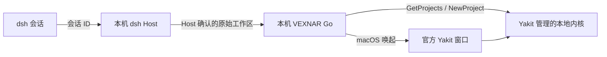

<!--
  Copyright (c) 2026 xuzhongxin <xuzhongxin@sec.hn.cn>
  Repository: https://github.com/zhongxinxuhk/VEXNAR
  SPDX-License-Identifier: AGPL-3.0-or-later
-->

# 官方 Yakit 本地联动

侧栏「流量」唤起官方 Yakit 窗口。会话里的「Yakit」使用该会话在 dsh Host 中记录的原始工作区，按需在 Yakit 中创建或复用项目。资产和流量管理在原生 Yakit 窗口内操作。

## 启用

1. 通过官方渠道安装并初始化 Yakit。Yakit 负责前端与内核的安装、运行和更新。VEXNAR 构建仅包含原生窗口跳转和项目连接器。 [Yakit 启动说明](https://yaklang.com/docs/startup/)
2. 「流量」入口通过 macOS Launch Services 打开 Yakit。会话自动登记项目还需要向 Go 提供 Yakit 本地 IPC 的连接信息。将同一用户已授权共享的 Unix socket 路径和私有认证文件路径分别设置为 `VEXNAR_YAKIT_SOCKET` 和 `VEXNAR_YAKIT_TOKEN_FILE`。socket 所在目录权限为 `0700`，socket 与一行认证文件权限为 `0600`。Yakit 自己轮换凭据或更换 socket 时，连接配置需要更新。
3. 打开有本地工作区的 dsh 会话，在新会话选项区或现有会话标题栏点击「Yakit」。状态文字会显示已登记的项目名。用 Yakit 自己的项目管理界面打开该项目。

## 边界

- VEXNAR 对工作区的规范化绝对路径做 SHA-256，以 `ExternalModule=vexnar` 和 `ExternalProjectCode` 识别项目。同一个目录在多个会话里共享 Yakit 项目，同名的不同目录各有独立项目。浏览器只传会话 ID。项目名字包含工作区末级名称和哈希前缀，完整路径留在本地。
- 连接器只调用 `GetProjects` 和 `NewProject`。Yakit 的项目切换是作用于全内核的操作，切换由原生项目管理界面执行。保持外部关联字段和生成的项目名可以在以后复用该项目。 [上游项目 API](https://github.com/yaklang/yaklang/blob/1.4.9-beta8/common/yakgrpc/grpc_project.go)
- 目前原生窗口跳转支持 macOS。未配置本地 IPC 时仍可打开 Yakit，界面会说明会话项目登记的配置状态。已有的 Go 流量、资产和证据 API 继续服务 Web 控制台和历史数据。
