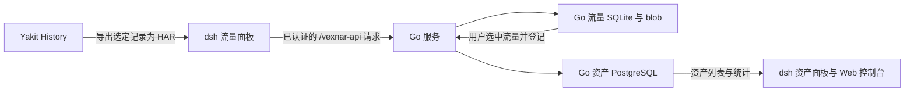

<!--
  Copyright (c) 2026 xuzhongxin <xuzhongxin@sec.hn.cn>
  Repository: https://github.com/zhongxinxuhk/VEXNAR
  SPDX-License-Identifier: AGPL-3.0-or-later
-->

# Yakit 历史流量与 VEXNAR 资产对接

当前 dsh 流量入口采用[Yak 内核 History](YAK-HISTORY.md)。下文记录此前的 HAR 导入链路及仍可调用的 Go API。

## 设计

- 内嵌 core 将流量列表、详情、Yakit 导入、流量登记，以及资产列表、计数和 JSON 导入转交本机 Go。请求须通过 dsh 会话认证，服务令牌由启动器注入。独立 TypeScript core 保留原迁移接口。
- 首批对接 Yakit History 的 HAR 导出。Go 按记录导入并返回成功、重复、失败数量和失败行号。相同记录可重试。时间优先使用 HAR 的 `startedDateTime`，随后使用 Yakit 的 `metaData.updated_at`，最后使用导入时间。报文预览使用 HAR 已导出的字段，正文沿用流量库和 blob 存储。
- 资产由用户从流量详情登记。一个事务内按协议、主机和端口合并 HTTP 服务，按方法与 URL 路径合并端点。登记产生全局资产，企业归属沿用 Go 的资产范围规则。查询值、片段及报文内容留在流量侧。
- 本批覆盖历史流量文件和从流量观察到的资产。Yakit 端口资产工作簿、任务归属和双向同步列为后续接入项，需先确定字段和归属的映射关系。

## 使用

1. 启动 Go 和 dsh。Go 默认地址为 `http://127.0.0.1:8787`。使用其他端口时在 dsh 启动器设置 `VEXNAR_GO_URL`。两侧使用同一 `VEXNAR_DESKTOP_TOKEN`。Go 的 `-proxy` 参数保留监听地址以初始化流量库。历史导入独立于 Go 实时捕获开关。
2. 打开 Yakit History，选中记录并导出 HAR。至少保留 URL 和 Method。报文详情还需要请求和响应字段，每批上限 16 MiB 或 2000 条。 [History 导出菜单源码](https://github.com/yaklang/yakit/blob/master/app/renderer/src/main/src/components/HTTPFlowTable/useHTTPFlowTableContextMenu.tsx) · [Yak HAR 字段定义](https://github.com/yaklang/yaklang/blob/main/common/har/har.go)
3. 在 dsh 的「流量」选择 HAR。导入成功后列表切到 Yakit 来源。打开一条记录，点击「登记为资产」。
4. 在「资产」按服务或端点查看登记结果。独立 core 本地库中已有的资产，可通过「资产同步」按 Go 的资产 JSON 契约重新导入。

## 验收

- 使用 dsh Web 打包产物，验证认证前后的 `/vexnar-api`，以及 Go 连接断开时的错误。
- 用 Yakit HAR 结构的样例验证导入、来源筛选、报文和重复导入。把一条流量登记为资产，确认 Go 与 dsh 读到同一服务、端点，且重复登记复用资产 ID。
- 在实际 Yakit 客户端复核所用版本的 HAR 选项及导出内容。
