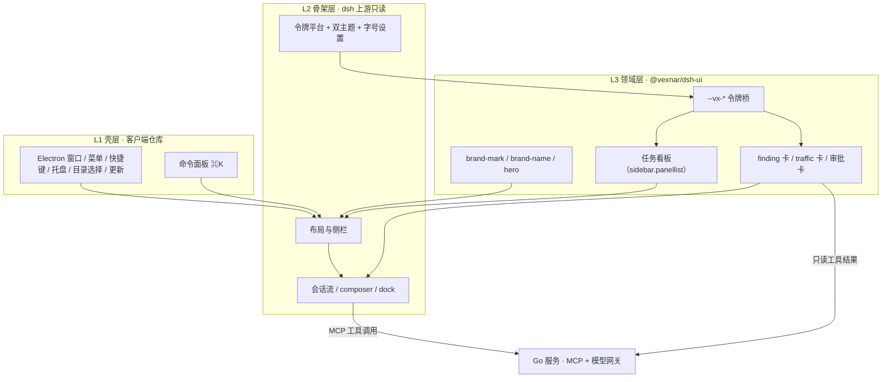

<!--
  Copyright (c) 2026 xuzhongxin <xuzhongxin@sec.hn.cn>
  Repository: https://github.com/zhongxinxuhk/VEXNAR
  SPDX-License-Identifier: AGPL-3.0-or-later
-->

# ZCode × dsh 融合 UI 设计分析：怎么融合，怎么把颜值做上去

> 版本：v1 · 2026-11-21
> 范围：`app/vexnar/ui`（VEXNAR 客户端插件）、`app/vexnar/cordis.patch.yml`（profile 覆盖层）、
> dsh 客户端壳与槽位、以及客户端仓库里的 Electron 壳。
> 不在范围：Go 服务、`web/` 控制台重构、dsh 上游源码改动。

---

## 0. 结论先说

1. **融合不是"把两套 UI 拼起来"，而是三层分工**：ZCode 贡献"壳与工作台气质"，dsh 贡献"布局、会话流与主题平台"，VEXNAR 只贡献"品牌 + 领域组件"。三者各有唯一归属，冲突面被压到槽位和令牌两层。
2. **颜值的第一杀手不是缺设计，而是"令牌没接上"**。当前 VEXNAR 卡片用了两个 **dsh 里根本不存在的令牌**（`--dsw-alias-bg-secondary`、`--dsw-alias-border-secondary`），于是全部退回硬编码十六进制：亮色下勉强能看，暗色下卡片是"白纸贴在黑屏上"，与 shell 的层级语言完全脱节。**这是本次要修的第一件事。**
3. **dsh 已经有一套成熟到可以直接继承的视觉平台**：三层令牌（static → alias → 组件）、`data-ds-dark-theme` 双主题、字号阶梯与用户字号增量、三档 elevation（发丝描边 + 双层柔光）、统一动效曲线、超椭圆圆角。VEXNAR 要做的是"接上去"，不是"再造一套"。
4. **`web/` 的 shadcn + Tailwind v4（oklch）令牌不能直接搬进 dsh**：两套变量命名、两套暗色机制、两种字体栈。正确做法是**在 web/ 与 dsh 之间建一层语义映射**，让同一个"危险/高危/成功"在两端指向各自令牌，而不是复制色值。
5. ZCode 不在本仓库参考树里，本文只借鉴其**交互结构与工作台气质**（Electron 壳、Chat/Project/Workspace 三段式、命令面板），不复制其代码与资产。
6. **皮肤层已选定 `dsh-claude-style`**（MIT，registry 包）：它接管 dsh 的 alias 令牌与界面细节，我们不再自建整套配色；VEXNAR 只做语义映射与领域组件（见 §4.7）。

---

## 1. 现状审计（有证据）

### 1.1 三层结构已经存在，只是没被当成架构用

| 层 | 归属 | 现状 |
|---|---|---|
| L1 壳层 | 客户端仓库（Electron） | 窗口、菜单、托盘、目录选择、安装更新；**不在本仓库** |
| L2 骨架层 | dsh 上游（`app/dsh`，只读） | 侧栏、会话流、composer、dock、设置页、权限选择器 |
| L3 领域层 | VEXNAR（`app/vexnar/ui`） | 品牌槽、hero、工具卡（finding / traffic）、权限警示 |

`app/vexnar/cordis.patch.yml` 已经按这个分层工作：只按 id 覆盖 dsh 的行（`ui-brand-official` 关闭、VEXNAR 占位），不 fork 上游组件。

### 1.2 dsh 的视觉平台（可继承的部分）

来自 `app/dsh/packages/client/ui-theme/src/styles/`（与 `docs/archive/dsh-ui-port-2026-11-21.patch` 里那份被丢弃的移植文件同源）：

| 维度 | 事实 | 对融合的意义 |
|---|---|---|
| 色板 | `--dsw-static-{neutral,neutral-bluish,blue,red,amber,green,violet,deepseek}-*` | 语义色直接取静态色阶，不自定义色值 |
| 语义层 | `--dsw-alias-bg-base/-layer-1..3`、`border-l1..l4`、`label-primary/secondary/tertiary`、`card-fill` | 卡片只需要 `bg-layer-2` + `border-l2` + `label-*` |
| 暗色 | `body[data-ds-dark-theme]` 重绑 alias 层 | 组件不写暗色分支，只写一次令牌 |
| 层级 | `--dsw-elevation-panel/-prominent/-soft` = 0.5px 发丝描边 + 双层柔光 | 卡片的"高级感"来源，替代重阴影 |
| 圆角 | `--dsw-radius-xs/sm/md/lg/xl/panel` + `--dsw-corner-shape: superellipse(1.5)` | 圆角带超椭圆曲率，比纯圆角更"贵" |
| 字体 | `--dsw-font-xs-13 / xxs-12 / xxxs-11 / s-14` 及其 strong 变体；`--dsh-content-font-delta` 跟随用户字号 | 卡片字号应取这三个阶梯，而不是自定 13/12/11 |
| 等宽 | `--ds-font-family-code`（SF Mono / JetBrains Mono / …） | 流量正文、请求行必须用这个栈 |
| 动效 | `--ds-ease-in-out`、`--ds-transition-duration{-fast,-slow}` | 全部过渡复用，不新增曲线 |
| 品牌字体 | `--dsw-font-family-brand`（Montserrat，仅品牌字） | 只给 VEXNAR wordmark 用 |

### 1.3 VEXNAR 现有实现的问题清单

| # | 问题 | 证据 | 视觉后果 |
|---|---|---|---|
| 1 | 两个令牌名不存在 | `src/client.tsx` 旧版用 `var(--dsw-alias-bg-secondary, …)`、`var(--dsw-alias-border-secondary, …)`；在 `app/dsh` 全量 CSS 中检索命中 0 次 | 卡片背景/描边恒为硬编码 `#f8fafc`/`#e5e7eb`，暗色下突兀 |
| 2 | 硬编码颜色散落 | chip 背景 `#fff`、severity `#b91c1c/#c2410c/#a16207/#15803d`、正文 `#fff` | 不跟随主题；与 shell 的 `label-*` 色阶不一致 |
| 3 | inline style 承载全部样式 | 组件里 `CSSProperties` 常量 | 无法 hover/focus/过渡，无法响应字号设置 |
| 4 | 无动效 | — | 卡片"啪"地出现，缺少入场与状态过渡 |
| 5 | 加载态是纯文本 | `LoadingCard` | 与 dsh 的骨架/加载语言不一致 |
| 6 | 分段控件是"两个胶囊按钮" | traffic 的"头/正文" | 不像控件，像标签 |
| 7 | 严重级只有颜色 | 无图标/形状 | 色盲与灰度打印下不可读 |
| 8 | 品牌字用系统字体 + 字距 | `BrandName` | 与侧栏其它文字同质，缺品牌感 |

### 1.4 `web/` 的令牌体系（差异点）

- Tailwind v4 + shadcn：`--background/--foreground/--card/--border/--primary/…`，**oklch** 取值，`.dark` class 切换；
- 三套主题预设：`brutalist`、`soft-pop`、`tangerine`（`web/src/styles/presets/`）；
- 字体：Geist / Geist Mono；
- 结论：**两套系统变量名、暗色机制、字体都不一样**。跨端一致要靠"语义对齐表"（见 §4.1），不能靠复制 CSS。

### 1.5 被丢弃但有用的资产

`docs/archive/dsh-ui-port-2026-11-21.patch`（19 个文件、184 KB）里保存了最后一次 dsh 外观移植：`Sidebar.module.css`、`ChatShell.module.css`、`Composer.module.css`、`Hero.module.css`、`Rows.module.css`、`WorkspaceBrowser.module.css`、`design-platform.css`、`gradient-shadow-text.css`、`scrollbar.css`。

这份补丁是**上游 MIT 代码的移植**，只在需要对齐某个细节（侧栏密度、行高、hover 态）时查阅，不整段搬回（它面向 Electron 渲染进程，选择器与我们现在的插件 DOM 不同）。

---

## 2. 融合策略：三层分工 + 一条数据流

### 2.1 分层与归属



| 层 | 谁改 | 允许做什么 | 禁止做什么 |
|---|---|---|---|
| L1 | 客户端仓库 | 窗口、系统菜单、多窗口、全局快捷键、自动更新 | 不改 dsh 组件、不直连数据库 |
| L2 | 上游（只读） | 升级 tag、按 id 禁用/替换行 | 改 `app/dsh` 源码 |
| L3 | 本仓库 `app/vexnar` | 槽位注册、令牌桥、领域组件 | 新造数据真相、绕过审批语义 |

### 2.2 融合点清单（当前已接 / 待接）

| 融合点 | 机制 | 状态 |
|---|---|---|
| 侧栏品牌标记 | `sidebar.brand.mark` 槽位 | ✅ 已接（占用即覆盖，`ui-brand-official` 关闭） |
| 侧栏品牌名 | `sidebar.brand.name` 槽位 | ✅ 已接 |
| 首页 hero 标识 | `conversation.hero.brand.mark` 槽位 | ✅ 已接 |
| 首页标语 | 无槽位 → 就地改写 + `data-vexnar-slogan` 标记 | ✅ 已接（脆弱点，见 §10） |
| 工具卡 | `tool.call.toolview` 按工具名 key 注册 | ✅ 两张卡 |
| 任务/漏洞看板 | `sidebar.panellist` | ⬜ 待接 |
| 审批卡 | `intercept_pending` 决策面 | ⬜ 待接（需先有 dsh 侧审批槽位映射） |
| 语义色/字号/圆角 | `--vx-*` → dsh alias | ✅ 本次落地 |
| 命令面板 | dsh `commands` + 壳层快捷键 | ⬜ 待接 |
| 工作区切换器 | ZCode 式 Project 切换（壳层） | ⬜ 待接 |

---

## 3. "颜值"的可执行定义

颜值不是形容词，是 8 条可检查的指标。任一条不满足，视觉质量就会"掉档"。

| # | 指标 | 量化标准 | 检查方式 |
|---|---|---|---|
| 1 | 令牌一致性 | 组件样式里十六进制出现次数 = 0（令牌 fallback 除外） | `grep -nE "#[0-9a-fA-F]{3,8}" src/**/*.tsx` |
| 2 | 对比度 | 正文 ≥ 4.5:1，次要文字 ≥ 3:1，亮/暗两套主题都测 | 取 `--vx-text`/`--vx-text-dim` 与 `--vx-surface` 计算 |
| 3 | 层级克制 | 只用 `--dsw-elevation-panel/-prominent/-soft` 三档 | 代码检索 `box-shadow` 字面量 |
| 4 | 动效统一 | 只允许 `--ds-ease-in-out`、0.1/0.2/0.3s 三档；`prefers-reduced-motion` 下归零 | 检索 `transition:`/`animation:` |
| 5 | 字号阶梯 | 只允许 13 / 12 / 11 / 14 四个阶梯（`--dsw-font-*`） | 检索 `font-size` 字面量 |
| 6 | 语义色收敛 | 5 级（critical/high/medium/low/info）+ 中性，不引入第 6 种 | 色板稽核 |
| 7 | 状态完整 | loading / empty / error / success 四态齐全，不允许"只有成功态" | 组件评审 |
| 8 | 密度一致 | 卡片行高 22px、内外边距与 shell 同节奏；随用户字号设置缩放 | 字号 10/14/22 三档截图 |

---

## 4. 设计令牌桥（VEXNAR → dsh）

### 4.1 语义映射表

| VEXNAR 语义 | dsh 令牌（亮） | dsh 令牌（暗） | 用途 |
|---|---|---|---|
| 卡片面 | `--dsw-alias-bg-layer-2`（白） | `neutral-bluish-850` | 工具卡、看板卡 |
| 下沉面 | `--dsw-alias-bg-layer-1` | `neutral-bluish-875` | 代码块、分段控件底 |
| 描边 | `--dsw-alias-border-l2` | `rgba(255,255,255,.12)` | 卡片、输入框 |
| 强描边 | `--dsw-alias-border-l3` | `rgba(255,255,255,.16)` | chip、分隔 |
| 主文字 | `--dsw-alias-label-primary` | `neutral-bluish-50` | 标题、正文 |
| 次文字 | `--dsw-alias-label-secondary` | `neutral-bluish-300` | 元信息 |
| 弱文字 | `--dsw-alias-label-tertiary` | `neutral-bluish-400` | 占位、编号 |
| 危险 | `--dsw-static-red-500` | `--dsw-static-red-400` | 严重/失败 |
| 高/中危 | `amber-600 / amber-500` | `amber-400` | 高、中 |
| 低危/成功 | `green-500` | `green-400` | 低危、完成 |
| 信息 | `blue-500` | `blue-400` | 提示、链接 |

绑定后的 VEXNAR 词表（`--vx-*`，见 `app/vexnar/ui/src/styles.ts`）：`surface`、`surface-sunken`、`border`、`border-strong`、`text`、`text-dim`、`text-faint`、`accent`、`negative`、`radius`、`radius-sm`、`elevation`、`mono`、`ease`、`dur`、`dur-fast`。组件只允许消费 `--vx-*`，`--vx-*` 只允许由 dsh 令牌赋值 —— 这样上游改色板时，我们一处不动。

### 4.2 品牌色决策（三选一，建议 A）

| 方案 | 做法 | 优点 | 风险 |
|---|---|---|---|
| **A（建议）** | 品牌保持中性，语义色只表状态；品牌识别靠 logo、wordmark 字距、hero 渐变 | 与 dsh 壳浑然一体；不会出现"彩色仪表盘"；暗色最稳 | 个性弱，需要细节（字距、渐变、超椭圆）撑住 |
| B | 引入 VEXNAR 品牌色（logo 取色），映射到 `--dsw-alias-brand-primary` | 识别度最高 | 与 dsh 的按钮/选中态冲突，需要逐个组件校准 |
| C | 全量沿用 `web/` 的 tangerine/soft-pop 预设 | 两端一致 | 把 dsh 变成另一副皮，与上游组件语言打架 |

选 A + 一点点 B：**只在"品牌出现的地方"用品牌色**（wordmark、hero 标语渐变、加载态微光），功能色一概用 dsh 语义色。

### 4.3 字体

- 正文：继承 `--dsw-font-family`（系统栈 + PingFang SC / 微软雅黑），不引入 webfont；
- 等宽：`--ds-font-family-code`；
- 品牌字：`--dsw-font-family-brand`（Montserrat）**仅用于 wordmark**，字距 `0.08em`；
- 字号：13（卡片正文/标题）、12（元信息/代码）、11（chip），跟随 `--dsh-content-font-delta` 缩放；
- 禁止：`font-weight: 510` 这类可变字重中间值（非可变字体在跨平台会跳变，dsh 的 CSS 注释里已写明）。

### 4.4 圆角与超椭圆

`--dsw-radius-sm(8) / md(12) / xl(20)`；当引擎支持 `corner-shape: superellipse(1.5)` 时，圆角自动变为超椭圆曲率。**卡片 = md，chip/分段控件 = xl（胶囊），代码块 = sm。** 不要引入新的圆角数值。

### 4.5 阴影与层级

只用三档 elevation。卡片的"贵"来自 0.5px 发丝描边 + 极淡柔光，而不是 `0 8px 24px rgba(0,0,0,.2)` 这种重投影。悬停时**不换阴影档位**，改为描边与面色变化（避免跳动）。

### 4.6 动效

| 场景 | 时长 | 曲线 | 备注 |
|---|---|---|---|
| 卡片入场 | 200ms | `--vx-ease` | `opacity 0→1` + `translateY(3px→0)` |
| hover / 焦点 | 100ms | 同上 | 只改背景、描边、颜色 |
| 加载旋转 | 0.8s linear | — | 12px 圆环，与 dsh loading 同尺寸 |
| 折叠/展开 | 200ms | 同上 | 高度动画走 CSS transition |
| reduced-motion | 0ms | — | 入场动画与旋转全关 |

### 4.7 皮肤：内嵌 dsh-claude-style

决定：**用成熟皮肤接管"整体观感"，VEXNAR 只做"语义 + 领域组件"**。理由与做法如下。

| 维度 | 结论 |
|---|---|
| 接入方式 | `dsh-claude-style` 作为 profile 依赖，并写进 `dsh.profile.bundles`；它自带 `dsh.bundle.patch`，`ui-skin-claude-style` 行由它自己插入 |
| 层级 | dsh 组装顺序：各 bundle patch → profile `cordis.patch.yml` → `$DSH_HOME` 补丁。我们的补丁仍最后生效，品牌槽/MCP/模型路由不被覆盖 |
| 令牌 | 皮肤重绑 `--dsw-alias-*`（`label-primary` 出现 188 次、`bg-layer-2` 21 次），VEXNAR 的 `--vx-*` 只绑定 alias，因此卡片自动跟随皮肤配色与亮暗 |
| 冲突面 | 皮肤在 `tool.call.toolview` 上注册自己的视图（文件类），与我们的两个 keyed 工具卡不撞键；品牌槽它不占 |
| 品牌保留 | 侧栏 logo、wordmark、hero 标语仍归 `@vexnar/dsh-ui`；皮肤改的是"皮肤"，不是"品牌归属" |
| 关闭 | `VEXNAR_THEME=off pnpm run setup` 可不装；已写入的 bundles 行需手工移除（脚本不自动删） |
| 许可 | 主题 MIT；`packages/client/src/features/sodium/` 与 `packages/engine/src/sheet-rewrite.ts` 为 Sodium 引擎，PolyForm Shield 1.0.0。**只作为依赖使用，不复制进仓库** |

对本文既有结论的影响：

- §4.2 的"品牌色选 A（中性 + 语义色）"仍然成立，但**色值由皮肤给**：我们不再维护自己的中性色阶。
- §4.5 的"三档 elevation、发丝描边、超椭圆"继续沿用 dsh 令牌，皮肤若调整这些令牌，我们自动跟随。
- §8 的 P4（主题预设 + 密度）改为"皮肤预设 + 我们只补密度与语义色校验"，工作量下降。

验证口径（皮肤加入后新增）：

1. 亮/暗两套 + 皮肤的六套预设各看一眼卡片：severity 颜色必须仍然可辨；
2. 皮肤切换后 `--vx-*` 解析出的仍是 alias 值（不得出现硬编码回退）；
3. 皮肤与我们的工具卡同屏时，不出现双重边框/双重阴影（皮肤自带卡片样式，必要时我们把 `--vx-elevation` 置 `none` 让位）。

### 4.8 密度

当前按 dsh 默认（行高 22px、卡片内边距 12/14）。规划三档：

| 档位 | 行高 | 卡片内边距 | 适用 |
|---|---|---|---|
| compact | 20px | 8/10 | 长会话、批量扫结果 |
| cozy（默认） | 22px | 12/14 | 日常 |
| comfortable | 24px | 14/18 | 演示、录屏 |

实现方式：`body[data-vx-density="compact"]` 上重绑 `--vx-*` 的间距与行高，不写三套组件。

---

## 5. 组件规格

### 5.1 侧栏品牌槽（`sidebar.brand.mark` / `.name`）

- 结构：logo（24px 槽位内绘制 32px，视觉重量与文字匹配）+ wordmark；
- 字号 13、字重 700、字距 0.08em、颜色 `--dsw-alias-brand-text`；
- 暗色：logo 需要浅色描边/浅底版本（当前单张 PNG 在深色侧栏上易"糊"）；
- 不做：渐变文字（品牌字要稳，渐变留给 hero）。

### 5.2 首页 hero

- logo 55% 放大占位（34px → 53px），保留槽位几何；
- 标语：`data-vexnar-slogan="1"` → 竖向渐变（`label-primary 35% → label-tertiary 100%`），`background-clip: text`；
- 兜底：渐变整体包在 `@supports ((-webkit-background-clip: text) or (background-clip: text))` 里；不支持该属性的引擎保持纯色文字，不会出现"透明字"。

### 5.3 漏洞卡（`report_finding`）

```text
┌──────────────────────────────────────────────┐
│ ● 严重   SQL 注入                #1024   证据流量 3 条 │
│ ┌──────────────────────────────────────────┐ │
│ │ summary / payload 摘要（最多 160px 高，可滚动）│ │
│ └──────────────────────────────────────────┘ │
│ 上报失败，见上方输出（仅 isError 时出现）        │
└──────────────────────────────────────────────┘
```

- 严重级：chip + 圆点（形状冗余，不只靠颜色）；`critical/high/medium/low/info` 五档，未知值降级为 `none`（"finding"）；
- 编号：`#id`，`--vx-text-faint`、tabular-nums；
- 证据条数：右对齐，`--vx-text-dim`；
- 长摘要：`--vx-pre`（等宽、下沉面、最多 160px 高）；
- 失败：描边与底色按 `--vx-negative` 混色，附一行错误说明；
- 不做：卡片内按钮（避免与 shell 的操作条冲突），复制走正文选择。

### 5.4 流量卡（`traffic_get`）

- 标题：HTTP 请求行/状态行（截断 64 字符，等宽），一眼看出"打的是哪个接口"；
- 字节数：`formatBytes`（B/KB/MB），tabular-nums；
- 分段控件：`vx-seg`（下沉底 + 白色滑块 + 选中投影），替代原来的"两个胶囊按钮"；
- 正文：`--vx-pre`，最多 320px 高，`word-break: break-word`；
- 复制：`vx-chip--action`，1.2s 反馈"已复制"，用 effect 清理定时器（避免卸载后 setState）。

### 5.5 任务看板（`sidebar.panellist`，待实现）

- 卡片：任务名（13/600）+ 状态点（running 呼吸、paused 琥珀、done 绿、failed 红）+ 进度（`findings` 计数、tokens）；
- 分组：进行中 / 已暂停 / 已完成，组内按最近活动排序；
- 空态：一句引导 + "去 web 控制台"链接；
- 数据：只订阅 MCP `list_tasks`/`get_task_graph` 的只读结果，不维护第二份真相。

### 5.6 审批卡（待实现）

- 结构：命令/请求摘要（等宽）+ 风险标签 + 三个动作（批准一次 / 批准本次任务 / 拒绝）；
- 颜色：拒绝 = `--vx-negative`，批准 = `label-primary`；
- 语义：**审批真相仍在 Go 的 `intercept_pending`**，客户端只提交决策，不缓存"已批准"。

### 5.7 空 / 加载 / 错误

| 状态 | 表现 |
|---|---|
| loading | 12px 旋转环 + 文案（`vx-loading`），不显示空卡片 |
| empty | 一行说明 + 一个主操作，不要插画 |
| error | 描边转 `--vx-negative`、底色 5% 混色、一行原因 |
| success | 不加绿色横幅；用状态点与计数表达 |

---

## 6. 布局与信息层级（ZCode 气质 vs dsh 聊天流）

ZCode 值得借的是"工作台"的组织方式，不是它的像素。

| 模式 | 布局 | 适用 | 借鉴点 |
|---|---|---|---|
| Chat | 单栏，内容最大宽 860px，居中 | 对话、追问、单点排查 | dsh 原生 |
| Work | 双栏：会话 60% + 任务/看板 40%（可折叠） | 长任务监控 | ZCode 的 Workspace 分栏 |
| Review | 三栏：会话 / 证据（流量、请求响应）/ 报告 | 漏洞复核、写报告 | ZCode 的 Project 结构 |

规则：

1. **一屏一个主动作**：主按钮唯一，其余降级为次要；
2. 侧栏宽度 260px，右栏 380px，内容区最小 640px；
3. 视觉重心在会话流中部，右侧栏用下沉面（`bg-layer-1`）与主流区分；
4. 不照搬：原生菜单栏、多标签页（与 dsh 单窗口模型冲突）、ZCode 的蓝色主色。

---

## 7. 主题与暗色

- 唯一开关：`body[data-ds-dark-theme]`（dsh 已实现），VEXNAR 不新增主题开关；
- 三级背景：`bg-base`（页面）→ `bg-layer-1`（右栏/下沉区）→ `bg-layer-2`（卡片）；
- 品牌图：暗色需要浅色版或加描边，否则边缘糊在黑底上；
- 对比度：chip 文字必须用 400 档（暗）而不是 500 档，否则在 `neutral-bluish-850` 上不足 4.5:1；
- 打印/灰度：严重级必须有形状差异（圆点/图标），不能只靠色相。

---

## 8. 实施路径

| 阶段 | 内容 | 落点 | 工作量 | 验收 |
|---|---|---|---|---|
| **P0（已落地）** | 令牌桥 + 卡片重写 + 动效 + reduced-motion + 加载态 | `app/vexnar/ui/src/styles.ts`、`client.tsx` | 0.5 天 | 暗/亮切换无硬编码色；构建与 typecheck 通过 |
| P1 | 任务看板（`sidebar.panellist`） | 新增 `src/board.tsx` | 1.5 天 | 三组卡片 + 空态；数据来自 MCP |
| P2 | 审批卡 | `src/approval.tsx` | 1 天 | 三动作 + 失败回滚提示 |
| P3 | 壳层：命令面板（⌘K）、工作区切换器、标题栏渐隐 | 客户端仓库 | 3–5 天 | 快捷键可达；与 dsh 焦点管理不冲突 |
| P4 | 主题预设（三套色相）+ 密度三档 + web/ 令牌导出 | `styles.ts` + `web/src/styles` | 2 天 | 两端语义色一致（同一张表驱动） |

依赖顺序：P0 → P1 → P2；P3 与 P4 可并行；P4 需要先定"语义色表"的唯一来源（建议放 `app/docs/` 下表 + JSON 导出）。

---

## 9. 验证方法

```bash
# 1. 构建与类型检查
cd app/vexnar/ui && npm run build && npm run typecheck

# 2. 起隔离的 dsh web（端口 3099，home 与安装版隔离）
cd app && npm run setup && npm run web

# 3. 人工检查清单
#   - 亮/暗主题切换：卡片底色、描边、chip 颜色全部跟随
#   - 字号设置 10 / 14 / 22：卡片文字随 --dsh-content-font-delta 缩放
#   - 系统「减少动态效果」：入场动画与旋转关闭
#   - 一次 report_finding + 一次 traffic_get：核对四态（loading/成功/空/错误）
```

自动化建议（P4 一起做）：

1. **令牌 lint**：`src/**/*.tsx` 禁止 `#` 颜色字面量（`styles.ts` 的 fallback 白名单）；
2. **对比度脚本**：读两套 alias 值，计算 `--vx-text`/`--vx-text-dim` 对 `--vx-surface` 的比值，低于阈值即失败；
3. **截图基线**：Playwright 打开 dsh web，固定会话与两张卡，亮/暗各一张，diff 阈值 0.1%。

---

## 10. 风险与边界

| # | 风险 | 影响 | 应对 |
|---|---|---|---|
| 1 | 上游 token 改名（如 `label-secondary` → 其它） | 卡片退回 fallback | 令牌桥集中在一个文件；fallback 保证可读；`upstream:check` 增加断言 |
| 2 | hero 标语靠 `[class*="titleGroup"]` 就地改写 | 上游改类名即失效 | 标记 `data-vexnar-slogan` 已降级为"可选增强"；P3 评估是否申请上游槽位 |
| 3 | 单占位槽位冲突（brand-official 未关） | 启动即抛错 | profile patch 已禁用官方品牌行；升级 dsh 后必须重跑 `upstream:check` |
| 4 | 渐变文字在旧引擎不显示 | 标题变透明 | 已用 `@supports` 包裹，旧引擎退回纯色（P0 已消除） |
| 5 | 卡片样式与 shell 争 `font-size` | 用户字号设置失效 | 只继承，不写死根字号 |
| 6 | 大流量正文（MB 级）阻塞渲染 | 卡顿 | 已在 320px 高内滚动；P2 增加"仅在展开时渲染正文" |
| 7 | 许可证 | 分发合规 | dsh 为 MIT，移植片段保留 NOTICE；VEXNAR 自写文件保持 AGPL 头 |
| 8 | **服务声明缺失导致插件静默失效** | 侧栏/hero 悄悄退回官方 fallback，构建与类型检查全绿 | `export const inject = ['slots']` 必须在模块作用域；`apply` 对空 `slots` 只告警不抛错；`test/client.smoke.test.mjs` 断言导出与注册清单 |

### 10.1 已发生的一次真实故障（2026-11-21）

现象：侧栏回到「DSH 本地构建 / DESKTOP EDITION」鲸鱼 fallback，hero 回到「探索未至之境」，卡片样式全部丢失。

根因：重写卡片时漏掉 `export const inject = ['slots']`，dsh 不注入 `slots` 服务，`apply()` 第一行注册即抛错，客户端插件整体不激活。`ui-sidebar` 的 `renderSlot(..., { fallback })` 用 `FishLogo` + `brand.localBuild` 兜底，所以界面上看不到任何报错。

排查路径：boot 日志确认 `vexnar-ui` 处于 `active` → 抓取的 client bundle 含品牌槽位 → Node 侧 stub 执行 `apply` 正常 → 对比上游 `ui-brand-official` 源码发现 `export const inject = ['slots']` → diff 上一提交，确认是本仓库丢失该声明。

教训：**"插件 active" 不等于 "客户端注册成功"**；验收必须看 DOM（槽位内容），不能只看构建结果。

---

## 11. 本次已落地的改动

| 文件 | 改动 |
|---|---|
| `app/vexnar/ui/src/styles.ts`（新增） | `--vx-*` 令牌桥；卡片/头部/标题/元信息/chip/分段控件/代码块/加载/品牌/渐变标语/动效/reduced-motion 全部样式；`installStyles()` 幂等注入 |
| `app/vexnar/ui/src/client.tsx` | 移除全部 inline 色值与 `CSSProperties` 常量；改用类名 + `data-*` 状态；严重级映射为 `Severity` 五档 + 圆点；流量卡标题取请求行、字节数友好化、分段控件改 `aria-pressed`；复制反馈改 `useEffect` 清理；`apply()` 先注入样式 |
| `app/vexnar/ui/lib/client.js` | 重新构建产物（147 KB） |
| `app/vexnar/ui/test/client.smoke.test.mjs`（新增） | 用 stub 加载构建产物：断言 `inject = ['slots']`、五个槽位注册清单、空 `slots` 不抛错、样式不引用不存在的令牌 |

验证结果：`npm run build` ✅、`npm run typecheck` ✅、bundle 中已无 `--dsw-alias-bg-secondary` / `--dsw-alias-border-secondary` 这两个不存在的令牌。
