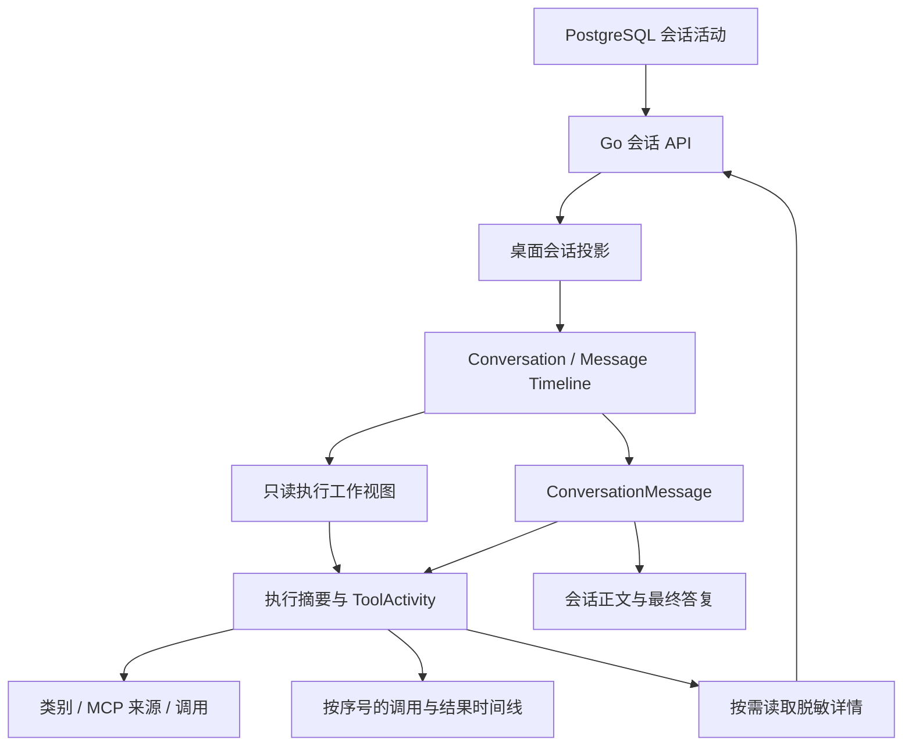

<!--
  Copyright (c) 2026 xuzhongxin <xuzhongxin@sec.hn.cn>
  Repository: https://github.com/zhongxinxuhk/VEXNAR
  SPDX-License-Identifier: AGPL-3.0-or-later
-->

# 实施与验收状态

核对日期为 2026-11-21。以下状态以当前分支可验证的行为为准。

| 范围 | 状态 | 验收依据 |
| --- | --- | --- |
| 桌面 Chat View | 已完成会话记录子范围 | 历史分页、增量追赶、重开流式回复、原始推理正文隐藏 |
| 只读工具记录 | 已完成 | 状态筛选、25 条每页、按事件序号排序、结果关联和跨页聚焦 |
| 会话活动持久化 | 已完成会话子范围 | Go 会话 API、PostgreSQL 17 与提供方观测的 11 项回归测试 |
| 桌面回归 | 已完成当前子范围 | 类型检查、114 项测试和 Electron 固定数据回归，覆盖 120 次调用与 240 条事件 |
| 独立 Execution Detail、Agent Workspace、统一事件存储与检查点 | 未交付 | 当前可用界面是会话内只读工具记录 |
| 独立运行时、调度器、路由、上下文与记忆、执行器和治理 | 未交付 | 现有系统的基础能力不计为本轮交付 |
| 200 Agent／500 活动任务 | 未验收 | 工具记录样本量与调度容量指标口径不同 |
| 三平台安装包、便携 PostgreSQL、安装验收、自动补丁版本与 Releases | 未交付 | 无本轮通过验收的安装包或正式发行 |

会话回放与详情见 `47ea04e0`，状态筛选和时间线见 `9fdcd2ef`，跨页定位见 `124ec8d6`。

## 自动化验收

`conversation-qa.yml` 在 GitHub 的 Windows x64、Linux x64 和 macOS arm64 运行器定义桌面类型检查和单元测试。macOS 额外执行固定数据 Electron 回归，Linux 另用 PostgreSQL 17 服务执行会话测试，官网执行构建和内容契约测试。当前已验证本地测试与工作流静态检查，GitHub 托管三平台运行尚未验收。

## 聊天 UI 重构核对

现有路径从 Go 写入 PostgreSQL 会话活动开始，桌面通过主进程 IPC 按序号读取历史和增量记录。原界面把答复和工具展示放在同一个消息组件；重构后，组件依赖为：

- 已交付并验证：消息层级与可访问标签、实际回合摘要、工具类别和 MCP 来源分组、筛选、排序、跨页关联、详情按需脱敏、长输出分段和会话手动停止的持久化状态。
- 当前会话活动中有事件序号、调用 ID、执行者、时间与结果状态。类别是依据工具名称或命名空间的展示映射。实际 Skill 父子关系、Browser / Software Session ID、DAG 依赖和执行器级重试或恢复需要后端保存相应事件，目前仍待实施。已交付只读执行工作视图。新记录显示本回合最后一个有响应的提供方所使用的已配置模型标识。旧记录没有模型事件时保留空白。
- 大记录由批量 DTO 传递元数据，调用列表每页最多 25 条，展开详情按 8,192 个 UTF-16 单元分段渲染。只读工具事件时间线采用虚拟滚动，在 240 条事件的桌面回归中最多挂载 19 行。未对生产负载作性能结论。

工具结果以记录中的调用 ID 和执行者关联。重复 ID 只在存在唯一候选时配对，时间线标明确实缺少调用或候选有歧义的结果。现有会话活动未记录 Skill 的真实父子边、执行器 Session ID 或任务依赖边。

跨页证据查询由 Go 会话 API 按选中的结果事件回查。查询限定在同一会话和同一回合，复用调用 ID 与执行者证据，返回调用元数据及关联状态。载荷继续由现有脱敏详情接口按需读取。
